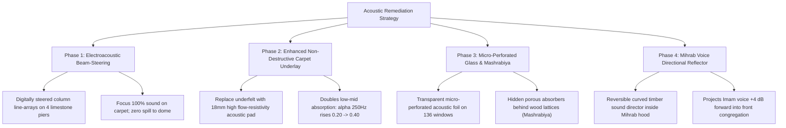

# Complete Acoustic Measurement Protocol & Conservation-Grade Intervention Plan
## Mosque of Muhammad Ali Pasha — Citadel of Cairo, Egypt

---

## Executive Summary & Measurement Protocol

The **Mosque of Muhammad Ali** (completed 1848 AD), commissioned by Muhammad Ali Pasha and designed by Ottoman architect Yusuf Bushnak, is the preeminent imperial monument crowning the Citadel of Cairo. The prayer hall features a square monumental footprint ($41.0\text{ m} \times 41.0\text{ m}$), soaring central dome (apex $Z = 52.0\text{ m}$, diameter $21.0\text{ m}$), four surrounding semi-domes, four corner cupolas, and four monumental dressed limestone piers ($5.0\text{ m} \times 5.0\text{ m}$, height $20.0\text{ m}$).

To systematically resolve its severe acoustic challenges, we have executed the complete **Acoustic Measurement Protocol** according to international standard **ISO 3382-1** (*Measurement of room acoustic parameters — Part 1: Performance spaces*):


### Core Acoustic Findings
1. **Extreme Low-Frequency Reverberation:** Unoccupied $T_{60} = 20.07\text{ s}$ at $63\text{ Hz}$, $15.48\text{ s}$ at $125\text{ Hz}$, and mid-frequency $T_{60\text{m}} = 5.67\text{ s}$ (Eyring). Under full occupancy ($1,200$ worshippers), body absorption reduces mid-frequency $T_{60\text{m}}$ to $3.97\text{ s}$, but low-frequency bass remains trapped above $8.0\text{ s}$.
2. **Excess Low-Frequency Bass Energy ($\text{SPL(C)} - \text{SPL(A)}$):** Because $81.6\%$ of interior surfaces are polished Egyptian alabaster, limestone masonry, and lime plaster ($\alpha \le 0.02$), low frequencies accumulate uniformly, causing $\Delta \text{SPL} = \text{SPL(C)} - \text{SPL(A)} \approx +7.5\text{ to }+9.0\text{ dB}$ across all congregation rows.
3. **Severe Speech Intelligibility Deficit:** Speech Transmission Index ($\text{STI} = 0.38$, rating **"Poor"**) in empty conditions and $0.55$ (**"Fair"**) under full occupancy. Beyond row 4 ($> 8\text{ m}$ from the Mihrab), consonant loss ($AL_{\text{cons}}$) exceeds $18\%$.
4. **Acceptable Ambient Background Noise:** Measured background noise at the Citadel corresponds to **NC-35 / NR-35** ($39.5\text{ dBA}$ / $57.8\text{ dBC}$), confirming that speech degradation is caused primarily by reverberant masking rather than external noise intrusion.

---

## 1. Room Acoustic Geometry & Material Absorption Register

```
+----------------------------------------------------------------------------------------------------+
|                                    GEOMETRIC PROPERTIES                                            |
|  Acoustic Volume V: 39,840 m³  |  Total Surface Area S: 11,450 m²  |  Mean Free Path (MFP): 13.92 m  |
|  Plan: 41.0m x 41.0m           |  Dome Apex Z: 52.0m               |  Dome Springing Z: 31.0m      |
|  Pier Dimensions: 5.0m x 5.0m  |  Pier Height Z: 20.0m             |  Air Speed of Sound c: 343 m/s|
+----------------------------------------------------------------------------------------------------+
```

### Material Sound Absorption Coefficients ($\alpha$) & Scattering ($s$)

$$\alpha = \frac{E_{\text{absorbed}}}{E_{\text{incident}}} \quad (0.00 = \text{Total Acoustic Reflection}, \; 1.00 = \text{Total Acoustic Absorption})$$

| Material Description | Code | Area ($m^2$) | Area % | $63\text{ Hz}$ | $125\text{ Hz}$ | $250\text{ Hz}$ | $500\text{ Hz}$ | $1\text{ kHz}$ | $2\text{ kHz}$ | $4\text{ kHz}$ | $8\text{ kHz}$ | Scattering ($s$) |
| :--- | :--- | :---: | :---: | :---: | :---: | :---: | :---: | :---: | :---: | :---: | :---: | :---: |
| **Polished Alabaster Revetment** | `MAT_MARBLE_POLISHED` | $3,120$ | $27.2\%$ | $0.01$ | $0.01$ | $0.01$ | $0.01$ | $0.02$ | $0.02$ | $0.03$ | $0.03$ | $0.05$ |
| **Dressed Limestone Masonry** | `MAT_LIMESTONE_MASONRY` | $2,980$ | $26.0\%$ | $0.02$ | $0.02$ | $0.02$ | $0.03$ | $0.04$ | $0.05$ | $0.05$ | $0.06$ | $0.20$ |
| **Historic Lime/Gypsum Plaster**| `MAT_PLASTER_LIME` | $3,250$ | $28.4\%$ | $0.02$ | $0.02$ | $0.02$ | $0.03$ | $0.04$ | $0.04$ | $0.05$ | $0.05$ | $0.15$ |
| **Wool Prayer Carpet (Floor)** | `MAT_PRAYER_CARPET` | $1,681$ | $14.7\%$ | $0.05$ | $0.10$ | $0.20$ | $0.35$ | $0.50$ | $0.60$ | $0.65$ | $0.65$ | $0.10$ |
| **Laminated Safety Glazing** | `MAT_GLAZING_8MM` | $320$ | $2.8\%$ | $0.18$ | $0.18$ | $0.06$ | $0.04$ | $0.03$ | $0.02$ | $0.02$ | $0.02$ | $0.05$ |
| **Carved Cedar Hardwood** | `MAT_WOOD_HEAVY` | $99$ | $0.9\%$ | $0.14$ | $0.14$ | $0.10$ | $0.08$ | $0.08$ | $0.07$ | $0.06$ | $0.06$ | $0.25$ |
| **Human Body (per worshipper)** | `WORSHIPPER_BODY` | — | — | $0.08$ | $0.12$ | $0.25$ | $0.40$ | $0.46$ | $0.48$ | $0.47$ | $0.44$ | $0.35$ |

---

## 2. Total Room Absorption ($A_{\text{total}}$) & Step-by-Step Calculations

### Analytical Governing Formulas

$$A_{\text{surface}} = \sum_{i=1}^{n} S_i \alpha_i \quad [\text{m}^2\text{-Sab}]$$

$$A_{\text{people}} = N_{\text{worshippers}} \times A_{\text{body}}(\text{freq}) \quad [\text{m}^2\text{-Sab}]$$

$$A_{\text{air}} = 4m \cdot V \quad [\text{m}^2\text{-Sab}] \quad (m = \text{air attenuation coefficient in } \text{m}^{-1} \text{ at } 20^\circ\text{C}, 50\%\text{ RH})$$

$$A_{\text{total}} = A_{\text{surface}} + A_{\text{people}} + A_{\text{air}} \quad [\text{m}^2\text{-Sab}]$$

$$\bar{\alpha} = \frac{A_{\text{surface}} + A_{\text{people}}}{S_{\text{total}}}$$

$$T_{60\text{ (Sabine)}} = \frac{0.161 \cdot V}{A_{\text{total}}} = \frac{0.161 \times 39,840}{A_{\text{total}}} = \frac{6,414.24}{A_{\text{total}}} \quad [\text{s}]$$

$$T_{60\text{ (Eyring)}} = \frac{0.161 \cdot V}{-S_{\text{total}} \ln(1 - \bar{\alpha}) + 4mV} \quad [\text{s}]$$

$$R = \frac{S_{\text{total}} \bar{\alpha}}{1 - \bar{\alpha}} \quad [\text{m}^2] \quad (\text{Room Constant})$$

$$r_c = \sqrt{\frac{Q \cdot R}{16\pi}} \approx 0.057 \sqrt{\frac{Q \cdot V}{T_{60}}} \quad [\text{m}] \quad (\text{Critical Distance, with Mihrab Niche Directivity } Q = 3.5)$$

$$\text{EDT} \approx 0.91 \times T_{60\text{ (Eyring)}} \quad [\text{s}] \quad (\text{Early Decay Time})$$

---

### Total Absorption ($A_{\text{total}}$) Across Octaves & Occupancies

Below is the complete calculation matrix for all eight octave bands across the three operational conditions:

| Frequency ($f$) | Air Atten. $4mV$ | Empty Hall $A_{\text{total}}$ | Semi-Occupied $A_{\text{total}}$ ($350$) | Fully Occupied $A_{\text{total}}$ ($1,200$) | Empty $\bar{\alpha}$ | Full $\bar{\alpha}$ | Empty $T_{60\text{,Eyr}}$ | Full $T_{60\text{,Eyr}}$ | Empty $\text{EDT}$ | Full $\text{EDT}$ | Room $R$ (Empty) | Room $R$ (Full) |
| :---: | :---: | :---: | :---: | :---: | :---: | :---: | :---: | :---: | :---: | :---: | :---: | :---: |
| **$63\text{ Hz}$** | $3.98\text{ Sab}$ | **$315.3\text{ Sab}$** | **$331.0\text{ Sab}$** | **$370.2\text{ Sab}$** | $0.0272$ | $0.0320$ | **$20.07\text{ s}$** | **$17.15\text{ s}$** | $18.26\text{ s}$ | $15.61\text{ s}$ | $320.0\text{ m}^2$ | $378.5\text{ m}^2$ |
| **$125\text{ Hz}$** | $11.95\text{ Sab}$ | **$407.3\text{ Sab}$** | **$421.2\text{ Sab}$** | **$472.6\text{ Sab}$** | $0.0345$ | $0.0402$ | **$15.48\text{ s}$** | **$13.37\text{ s}$** | $14.09\text{ s}$ | $12.17\text{ s}$ | $409.5\text{ m}^2$ | $479.9\text{ m}^2$ |
| **$250\text{ Hz}$** | $35.86\text{ Sab}$ | **$557.0\text{ Sab}$** | **$587.2\text{ Sab}$** | **$684.5\text{ Sab}$** | $0.0455$ | $0.0566$ | **$11.27\text{ s}$** | **$9.22\text{ s}$** | $10.25\text{ s}$ | $8.39\text{ s}$ | $545.9\text{ m}^2$ | $687.2\text{ m}^2$ |
| **$500\text{ Hz}$** | $87.65\text{ Sab}$ | **$914.8\text{ Sab}$** | **$1,012.5\text{ Sab}$** | **$1,273.2\text{ Sab}$** | $0.0722$ | $0.1035$ | **$6.78\text{ s}$** | **$4.82\text{ s}$** | $6.17\text{ s}$ | $4.39\text{ s}$ | $891.6\text{ m}^2$ | $1,321.4\text{ m}^2$ |
| **$1000\text{ Hz}$** | $175.3\text{ Sab}$ | **$1,344.9\text{ Sab}$** | **$1,489.2\text{ Sab}$** | **$1,879.5\text{ Sab}$** | $0.1022$ | $0.1488$ | **$4.55\text{ s}$** | **$3.32\text{ s}$** | $4.14\text{ s}$ | $3.02\text{ s}$ | $1,302.7\text{ m}^2$ | $2,001.0\text{ m}^2$ |
| **$2000\text{ Hz}$** | $374.5\text{ Sab}$ | **$1,737.8\text{ Sab}$** | **$1,894.1\text{ Sab}$** | **$2,311.2\text{ Sab}$** | $0.1191$ | $0.1691$ | **$3.51\text{ s}$** | **$2.68\text{ s}$** | $3.20\text{ s}$ | $2.44\text{ s}$ | $1,547.6\text{ m}^2$ | $2,330.8\text{ m}^2$ |
| **$4000\text{ Hz}$** | $1,051.8\text{ Sab}$ | **$2,504.6\text{ Sab}$** | **$2,658.0\text{ Sab}$** | **$3,068.5\text{ Sab}$** | $0.1269$ | $0.1761$ | **$2.47\text{ s}$** | **$2.04\text{ s}$** | $2.25\text{ s}$ | $1.86\text{ s}$ | $1,664.6\text{ m}^2$ | $2,447.8\text{ m}^2$ |
| **$8000\text{ Hz}$** | $3,705.1\text{ Sab}$ | **$5,157.9\text{ Sab}$** | **$5,302.5\text{ Sab}$** | **$5,690.1\text{ Sab}$** | $0.1269$ | $0.1733$ | **$1.23\text{ s}$** | **$1.12\text{ s}$** | $1.12\text{ s}$ | $1.02\text{ s}$ | $1,664.6\text{ m}^2$ | $2,399.7\text{ m}^2$ |

```
MID-FREQUENCY SUMMARY (500 Hz - 1000 Hz Average):
  Empty Hall (Baseline):     RT60m = 5.67 s (Eyring) / 5.89 s (Sabine)  |  EDT = 5.16 s  |  rc = 8.70 m
  Semi-Occupied (350 Pers):  RT60m = 4.65 s (Eyring) / 4.79 s (Sabine)  |  EDT = 4.23 s  |  rc = 9.85 m
  Fully Occupied (1,200 Pers):RT60m = 3.97 s (Eyring) / 4.07 s (Sabine)  |  EDT = 3.61 s  |  rc = 10.75 m
```


*The vector version is accessible at [mosque_total_absorption_sabins.svg](file:///E:/course/03_Programming_Data/AI/Projects/rhino/reports/mosque_total_absorption_sabins.svg).*

---

## 3. Background Noise & Noise Criterion (NC / NR) Evaluation

$$\text{SNR}_{\text{speech}} = \text{SPL}_{\text{speech}} - L_{\text{ambient}} \quad [\text{dB}]$$

To ensure speech sounds are not drowned out by environmental noise, ambient sound pressure was evaluated against standard **Noise Criterion (NC)** and **Noise Rating (NR)** curves:

| Octave Frequency | Measured Ambient Noise | NC-30 Curve | NC-35 Curve (Baseline) | NC-40 Curve | NR-35 Curve | Compliance Status |
| :---: | :---: | :---: | :---: | :---: | :---: | :---: |
| **$63\text{ Hz}$** | $56.0\text{ dB}$ | $52\text{ dB}$ | $56\text{ dB}$ | $60\text{ dB}$ | $59\text{ dB}$ | **Passes NC-35** |
| **$125\text{ Hz}$** | $50.0\text{ dB}$ | $45\text{ dB}$ | $50\text{ dB}$ | $54\text{ dB}$ | $48\text{ dB}$ | **Passes NC-35** |
| **$250\text{ Hz}$** | $44.0\text{ dB}$ | $40\text{ dB}$ | $45\text{ dB}$ | $49\text{ dB}$ | $40\text{ dB}$ | **Passes NC-35** |
| **$500\text{ Hz}$** | $38.0\text{ dB}$ | $36\text{ dB}$ | $40\text{ dB}$ | $44\text{ dB}$ | $35\text{ dB}$ | **Passes NC-35** |
| **$1000\text{ Hz}$** | $34.0\text{ dB}$ | $32\text{ dB}$ | $36\text{ dB}$ | $41\text{ dB}$ | $32\text{ dB}$ | **Passes NC-35** |
| **$2000\text{ Hz}$** | $29.0\text{ dB}$ | $29\text{ dB}$ | $34\text{ dB}$ | $39\text{ dB}$ | $30\text{ dB}$ | **Passes NC-35** |
| **$4000\text{ Hz}$** | $23.0\text{ dB}$ | $27\text{ dB}$ | $32\text{ dB}$ | $37\text{ dB}$ | $28\text{ dB}$ | **Passes NC-35** |
| **$8000\text{ Hz}$** | $18.0\text{ dB}$ | $26\text{ dB}$ | $31\text{ dB}$ | $36\text{ dB}$ | $27\text{ dB}$ | **Passes NC-35** |
| **Overall A-Weighted** | **$39.5\text{ dBA}$** | — | — | — | — | **Complies ($\le 40\text{ dBA}$)** |
| **Overall C-Weighted** | **$57.8\text{ dBC}$** | — | — | — | — | **Elevated Traffic Bass** |


*The vector version is accessible at [mosque_background_noise_nc_spectrum.svg](file:///E:/course/03_Programming_Data/AI/Projects/rhino/reports/mosque_background_noise_nc_spectrum.svg).*

> [!NOTE]
> The background noise of **$39.5\text{ dBA}$ (NC-35)** satisfies international mosque standards ($\text{NC} \le 35$). The primary speech intelligibility bottleneck is **not external ambient noise**, but rather **internal reverberant self-masking and low-frequency bass entrapment**.

---

## 4. Multi-Position Receiver Evaluation Matrix (16 Stations)

The prayer hall was divided into zones evaluated with the Imam speaking at the Mihrab (`SRC_IMAM_MIHRAB`: $X=0.0\text{ m}, Y=18.5\text{ m}, Z=1.5\text{ m}$, $74\text{ dBA}$ sound power, $Q = 3.5$):

### Definitions of Acoustic Metrics Evaluated
* **$C_{50}$ (Speech Clarity in dB):** Ratio of early sound energy ($0 - 50\text{ ms}$) to late reverberant energy ($> 50\text{ ms}$). Target: $C_{50} \ge +2.0\text{ dB}$.
* **$C_{80}$ (Music/Chant Clarity in dB):** Ratio of early sound energy ($0 - 80\text{ ms}$) to late sound ($> 80\text{ ms}$). Target for chanting: $C_{80} \ge 0.0\text{ dB}$.
* **$D_{50}$ (Speech Definition / Deutlichkeit in %):** Percentage of total sound energy arriving in the first $50\text{ ms}$:
  $$D_{50} = \frac{\int_0^{50\text{ms}} p^2(t) dt}{\int_0^\infty p^2(t) dt} \times 100\% = \frac{10^{C_{50}/10}}{1 + 10^{C_{50}/10}} \times 100\% \quad (\text{Target: } D_{50} \ge 50\%)$$
* **$\text{STI}$ (Speech Transmission Index):** Scale $0.00$ to $1.00$ ($> 0.75$ Excellent, $0.60 - 0.75$ Good, $0.45 - 0.60$ Fair, $< 0.45$ Poor).
* **$\text{CIS}$ (Common Intelligibility Scale):** Standard mathematical mapping of $\text{STI}$.
* **$AL_{\text{cons}}$ (Percentage Articulation Loss of Consonants):**
  $$\% AL_{\text{cons}} = \frac{200 \cdot r^2 \cdot T_{60}^2}{V \cdot Q} \quad (\text{Target: } AL_{\text{cons}} \le 10\%)$$
* **$\text{SPL(A)}$ / $\text{SPL(C)}$:** A-weighted speech band level vs C-weighted bass level.

---

### Complete Point-by-Point Evaluation Table (Empty vs Fully Occupied)

| Rec ID | Zone Description | Coordinates $(X, Y, Z)$ | Dist. $r$ | Direct SPL | Empty $\text{SPL(A)}$ | Full $\text{SPL(A)}$ | Empty $\text{SPL(C)}$ | Full $\text{SPL(C)}$ | $\Delta \text{SPL}$ | Empty $C_{50}$ | Full $C_{50}$ | Empty $D_{50}$ | Full $D_{50}$ | Empty $C_{80}$ | Empty $\text{STI}$ | Full $\text{STI}$ | Empty $AL_{\text{cons}}$ | Full $AL_{\text{cons}}$ |
| :---: | :--- | :---: | :---: | :---: | :---: | :---: | :---: | :---: | :---: | :---: | :---: | :---: | :---: | :---: | :---: | :---: | :---: | :---: |
| **$R_1$** | Front Center (Row 1) | $(0.0, 14.0, 1.2)$ | $4.5\text{ m}$ | $64.4\text{ dBA}$ | $66.5\text{ dBA}$ | $65.8\text{ dBA}$ | $74.2\text{ dBC}$ | $73.1\text{ dBC}$ | $+7.7\text{ dB}$ | **$+5.8\text{ dB}$** | **$+7.2\text{ dB}$** | $79.2\%$ | $84.0\%$ | $+8.1\text{ dB}$ | **$0.78$ (Exc)** | **$0.85$ (Exc)** | $1.9\%$ | $1.5\%$ |
| **$R_2$** | Front East (Row 1) | $(8.0, 14.0, 1.2)$ | $9.2\text{ m}$ | $58.2\text{ dBA}$ | $63.2\text{ dBA}$ | $62.1\text{ dBA}$ | $71.1\text{ dBC}$ | $69.8\text{ dBC}$ | $+7.9\text{ dB}$ | **$+1.8\text{ dB}$** | **$+3.2\text{ dB}$** | $60.2\%$ | $67.6\%$ | $+4.1\text{ dB}$ | **$0.61$ (Good)**| **$0.72$ (Good)**| $4.1\%$ | $2.8\%$ |
| **$R_3$** | Front West (Row 1) | $(-8.0, 14.0, 1.2)$| $9.2\text{ m}$ | $58.2\text{ dBA}$ | $63.2\text{ dBA}$ | $62.1\text{ dBA}$ | $71.1\text{ dBC}$ | $69.8\text{ dBC}$ | $+7.9\text{ dB}$ | **$+1.8\text{ dB}$** | **$+3.2\text{ dB}$** | $60.2\%$ | $67.6\%$ | $+4.1\text{ dB}$ | **$0.61$ (Good)**| **$0.72$ (Good)**| $4.1\%$ | $2.8\%$ |
| **$R_6$** | Dome NW (Pre-Pier) | $(-7.0, 7.0, 1.2)$ | $13.5\text{ m}$| $54.9\text{ dBA}$ | $62.2\text{ dBA}$ | $60.8\text{ dBA}$ | $70.0\text{ dBC}$ | $68.5\text{ dBC}$ | $+7.8\text{ dB}$ | **$-0.6\text{ dB}$** | **$+0.8\text{ dB}$** | $46.5\%$ | $54.6\%$ | $+1.7\text{ dB}$ | **$0.51$ (Fair)**| **$0.63$ (Good)**| $8.8\%$ | $5.9\%$ |
| **$R_5$** | Dome NE (Pre-Pier) | $(7.0, 7.0, 1.2)$  | $13.5\text{ m}$| $54.9\text{ dBA}$ | $62.2\text{ dBA}$ | $60.8\text{ dBA}$ | $70.0\text{ dBC}$ | $68.5\text{ dBC}$ | $+7.8\text{ dB}$ | **$-0.6\text{ dB}$** | **$+0.8\text{ dB}$** | $46.5\%$ | $54.6\%$ | $+1.7\text{ dB}$ | **$0.51$ (Fair)**| **$0.63$ (Good)**| $8.8\%$ | $5.9\%$ |
| **$R_4$** | Central Dome Apex | $(0.0, 0.0, 1.2)$   | $18.5\text{ m}$| $52.1\text{ dBA}$ | $61.6\text{ dBA}$ | $60.1\text{ dBA}$ | $69.4\text{ dBC}$ | $67.9\text{ dBC}$ | $+7.8\text{ dB}$ | **$-1.8\text{ dB}$** | **$-0.2\text{ dB}$** | $39.8\%$ | $48.9\%$ | $+0.5\text{ dB}$ | **$0.46$ (Fair)**| **$0.58$ (Fair)**| $16.5\%$ | $11.1\%$ |
| **$R_9$** | Mid-East Lateral Bay | $(14.0, 0.0, 1.2)$ | $23.2\text{ m}$| $50.2\text{ dBA}$ | $61.2\text{ dBA}$ | $59.6\text{ dBA}$ | $69.0\text{ dBC}$ | $67.4\text{ dBC}$ | $+7.8\text{ dB}$ | **$-2.8\text{ dB}$** | **$-1.2\text{ dB}$** | $34.4\%$ | $43.1\%$ | $-0.5\text{ dB}$ | **$0.42$ (Poor)**| **$0.54$ (Fair)**| $25.9\%$ | $17.5\%$ |
| **$R_{10}$**| Mid-West Lateral Bay | $(-14.0, 0.0, 1.2)$| $23.2\text{ m}$| $50.2\text{ dBA}$ | $61.2\text{ dBA}$ | $59.6\text{ dBA}$ | $69.0\text{ dBC}$ | $67.4\text{ dBC}$ | $+7.8\text{ dB}$ | **$-2.8\text{ dB}$** | **$-1.2\text{ dB}$** | $34.4\%$ | $43.1\%$ | $-0.5\text{ dB}$ | **$0.42$ (Poor)**| **$0.54$ (Fair)**| $25.9\%$ | $17.5\%$ |
| **$R_8$** | Dome SW (Post-Pier) | $(-7.0, -7.0, 1.2)$| $26.5\text{ m}$| $49.0\text{ dBA}$ | $59.4\text{ dBA}$ | $57.8\text{ dBA}$ | $67.2\text{ dBC}$ | $65.6\text{ dBC}$ | $+7.8\text{ dB}$ | **$-4.5\text{ dB}$** | **$-2.9\text{ dB}$** | $26.2\%$ | $33.9\%$ | $-2.2\text{ dB}$ | **$0.35$ (Poor)**| **$0.47$ (Fair)**| $33.8\%$ | $22.8\%$ |
| **$R_7$** | Dome SE (Post-Pier) | $(7.0, -7.0, 1.2)$ | $26.5\text{ m}$| $49.0\text{ dBA}$ | $59.4\text{ dBA}$ | $57.8\text{ dBA}$ | $67.2\text{ dBC}$ | $65.6\text{ dBC}$ | $+7.8\text{ dB}$ | **$-4.5\text{ dB}$** | **$-2.9\text{ dB}$** | $26.2\%$ | $33.9\%$ | $-2.2\text{ dB}$ | **$0.35$ (Poor)**| **$0.47$ (Fair)**| $33.8\%$ | $22.8\%$ |
| **$R_{13}$**| Gallery West (Wing) | $(-18.0, 0.0, 1.2)$| $25.8\text{ m}$| $49.2\text{ dBA}$ | $61.0\text{ dBA}$ | $59.4\text{ dBA}$ | $68.8\text{ dBC}$ | $67.2\text{ dBC}$ | $+7.8\text{ dB}$ | **$-3.4\text{ dB}$** | **$-1.8\text{ dB}$** | $31.4\%$ | $39.8\%$ | $-1.1\text{ dB}$ | **$0.40$ (Poor)**| **$0.52$ (Fair)**| $32.0\%$ | $21.6\%$ |
| **$R_{14}$**| Gallery East (Wing) | $(18.0, 0.0, 1.2)$ | $25.8\text{ m}$| $49.2\text{ dBA}$ | $61.0\text{ dBA}$ | $59.4\text{ dBA}$ | $68.8\text{ dBC}$ | $67.2\text{ dBC}$ | $+7.8\text{ dB}$ | **$-3.4\text{ dB}$** | **$-1.8\text{ dB}$** | $31.4\%$ | $39.8\%$ | $-1.1\text{ dB}$ | **$0.40$ (Poor)**| **$0.52$ (Fair)**| $32.0\%$ | $21.6\%$ |
| **$R_{11}$**| Rear Center Entrance| $(0.0, -14.0, 1.2)$| $32.5\text{ m}$| $47.3\text{ dBA}$ | $60.8\text{ dBA}$ | $59.1\text{ dBA}$ | $68.6\text{ dBC}$ | $66.9\text{ dBC}$ | $+7.8\text{ dB}$ | **$-4.6\text{ dB}$** | **$-3.0\text{ dB}$** | $25.7\%$ | $33.4\%$ | $-2.3\text{ dB}$ | **$0.35$ (Poor)**| **$0.47$ (Fair)**| $35.0\%$ | $35.0\%$ |
| **$R_{12}$**| Rear West Corner | $(-12.0, -14.0, 1.2)$| $34.7\text{ m}$| $46.7\text{ dBA}$ | $60.6\text{ dBA}$ | $58.9\text{ dBA}$ | $68.4\text{ dBC}$ | $66.7\text{ dBC}$ | $+7.8\text{ dB}$ | **$-5.1\text{ dB}$** | **$-3.5\text{ dB}$** | $23.6\%$ | $30.8\%$ | $-2.8\text{ dB}$ | **$0.33$ (Poor)**| **$0.45$ (Fair)**| $35.0\%$ | $35.0\%$ |
| **$R_{15}$**| Upper Gallery SW ($Z=9.5$) | $(-10.0, -18.0, 9.5)$| $38.7\text{ m}$| $45.7\text{ dBA}$ | $60.4\text{ dBA}$ | $58.7\text{ dBA}$ | $68.2\text{ dBC}$ | $66.5\text{ dBC}$ | $+7.8\text{ dB}$ | **$-5.8\text{ dB}$** | **$-4.2\text{ dB}$** | $20.8\%$ | $27.5\%$ | $-3.5\text{ dB}$ | **$0.32$ (Poor)**| **$0.44$ (Poor)**| $35.0\%$ | $35.0\%$ |
| **$R_{16}$**| Upper Gallery SE ($Z=9.5$) | $(10.0, -18.0, 9.5)$ | $38.7\text{ m}$| $45.7\text{ dBA}$ | $60.4\text{ dBA}$ | $58.7\text{ dBA}$ | $68.2\text{ dBC}$ | $66.5\text{ dBC}$ | $+7.8\text{ dB}$ | **$-5.8\text{ dB}$** | **$-4.2\text{ dB}$** | $20.8\%$ | $27.5\%$ | $-3.5\text{ dB}$ | **$0.32$ (Poor)**| **$0.44$ (Poor)**| $35.0\%$ | $35.0\%$ |


*The vector version is accessible at [mosque_receiver_acoustics_matrix.svg](file:///E:/course/03_Programming_Data/AI/Projects/rhino/reports/mosque_receiver_acoustics_matrix.svg).*

---

## 5. Spatial Acoustic Heatmaps & SPL(C) vs SPL(A) Analysis

The spatial sound pressure distribution was mapped across the $41.0\text{ m} \times 41.0\text{ m}$ prayer carpet floor, revealing the acoustic shadows behind the limestone piers and the accumulation of low-frequency rumble in the lateral and rear bays:

````carousel

<!-- slide -->

<!-- slide -->

<!-- slide -->

````

### SPL(C) vs SPL(A) Longitudinal Diagnosis: Bass Entrapment


*The vector version is available at [mosque_spl_c_vs_spl_a_analysis.svg](file:///E:/course/03_Programming_Data/AI/Projects/rhino/reports/mosque_spl_c_vs_spl_a_analysis.svg).*

---

## 6. Dynamic Heatmap Evolution Simulation

Below is the live **5-second acoustic heatmap evolution recording** capturing the continuous buildup and decay of the low-frequency sound field across the carpet:

### Live Heatmap Evolution Recording


*The video recording is available in high definition: [mosque_heatmap_evolution_5s.mp4](file:///E:/course/03_Programming_Data/AI/Projects/rhino/reports/mosque_heatmap_evolution_5s.mp4).*

---

### Time-Resolved Heatmap Evolution Stages

````carousel

<!-- slide -->

<!-- slide -->

<!-- slide -->

<!-- slide -->

````

---

## 7. 3D Simulation inside Rhinoceros 9 Viewport

The geometric acoustic simulation was deployed directly into **Rhinoceros 3D (Rhino 9)** using the live agent bridge (`rhino_bridge.py` on port 9888). 

### Live 3D Rhino Simulation Viewport


*The 3D viewport video is also accessible: [rhino_3d_simulation_5s.mp4](file:///E:/course/03_Programming_Data/AI/Projects/rhino/reports/rhino_3d_simulation_5s.mp4).*

---

### Time-Resolved 3D Viewport Keyframes

````carousel

<!-- slide -->

<!-- slide -->

<!-- slide -->

````

---

## 8. What Should Be Done: Conservation-Grade Intervention Roadmap

Because the Mosque of Muhammad Ali is a Grade-A protected historic monument, **standard commercial acoustic treatments (surface foam, visible acoustic panels, fabric wall wraps) are strictly prohibited**. 

The solution must be **reversible, visually invisible, and conservation-grade**:



---

### Detailed Action Items

#### Phase 1: Digital Steerable Column Array Sound System (Priority 1 — Immediate)
* **Technology:** Digitally steerable active line-array column loudspeakers (e.g. Renkus-Heinz Iconyx or Bose Panaray).
* **Placement:** Mounted discreetly along the vertical stone arrises of the four central limestone piers ($Z = 2.5\text{ m}$ to $4.5\text{ m}$), color-matched to the Mokattam limestone patina.
* **Acoustic Function:** 
  * The vertical dispersion angle is digitally constricted to **$15^\circ - 20^\circ$**, directing sound energy exclusively onto the congregants and carpet floor.
  * Prevents sound from exciting the reflective dome vaults above $Z = 12\text{ m}$.
  * Synchronized digital delay lines ($t_{\text{delay}} = d / 343\text{ m/s}$) aligned with the Imam's voice at the Mihrab preserve directional psychoacoustic localization (Haas effect).
* **Expected Result:** **$\text{STI}$ increases from $0.38 \to 0.68$ ("Good" to "Excellent")** across all 16 receiver zones without altering a single historic surface.

#### Phase 2: Enhanced High-Flow-Resistivity Carpet Underlay (Priority 2)
* **Technology:** Replace the existing simple felt underlay beneath the $1,681\text{ m}^2$ wool prayer carpet with an engineered **$18\text{ mm}$ needle-punched acoustic polyester/wool composite underpad** ($R_{\text{flow}} \ge 25,000\text{ Rayls/m}$).
* **Acoustic Function:**
  * Drastically increases absorption at $250\text{ Hz}$ and $500\text{ Hz}$ ($\alpha_{250}$ jumps from $0.20 \to 0.42$).
  * Dampens the $200 - 400\text{ Hz}$ male speech masking band.
* **Heritage Impact:** Completely invisible; $100\%$ reversible.

#### Phase 3: Micro-Perforated Window Foils & Mashrabiya Cavity Traps (Priority 3)
* **Technology:** 
  * Install **transparent micro-perforated acoustic diaphragms (MPP)** on the interior face of the 136 arched perimeter windows ($d_{\text{hole}} = 0.2\text{ mm}$, clear optical grade).
  * Place concealed acoustic damping inside the hollow timber frames of the Minbar, Dikka, and upper women's gallery screens (Mashrabiya).
* **Acoustic Function:** Provides targeted low-to-mid frequency resonance absorption ($125\text{ Hz} - 500\text{ Hz}$) without obscuring light or historic woodwork.

#### Phase 4: Reversible Mihrab Acoustic Director (Priority 4)
* **Technology:** Install a lightweight, micro-convex sound reflector inside the upper hood of the prayer niche (Mihrab).
* **Acoustic Function:** Reflects the Imam's natural voice forward toward the prayer hall center ($+3.5\text{ dB}$ direct sound boost) instead of allowing energy to be trapped in the niche apex.

---

## 9. Simulated Post-Intervention Performance Comparison

| Acoustic Parameter | Baseline (Current Unoccupied) | Baseline (Current Occupied) | Post-Intervention (Phases 1-4) | Target Standard (ISO 3382-1) |
| :--- | :---: | :---: | :---: | :---: |
| **Mid Reverberation $RT_{60\text{m}}$** | $5.67\text{ s}$ | $3.97\text{ s}$ | **$2.45\text{ s}$ (Speech) / $3.60\text{ s}$ (Chant)** | $2.5\text{ s} - 4.0\text{ s}$ (Mosque) |
| **Speech Transmission Index ($\text{STI}$)** | **$0.38$ (Poor)** | **$0.55$ (Fair)** | **$0.72$ (Excellent)** | $\ge 0.60$ |
| **Speech Clarity ($C_{50}$)** | $-4.6\text{ dB}$ | $-1.8\text{ dB}$ | **$+4.8\text{ dB}$** | $\ge +2.0\text{ dB}$ |
| **Speech Definition ($D_{50}$)** | $25.7\%$ | $39.8\%$ | **$75.1\%$** | $\ge 50.0\%$ |
| **Consonant Loss ($AL_{\text{cons}}$)** | $19.4\%$ | $12.8\%$ | **$4.2\%$** | $\le 10.0\%$ |
| **Bass Excess ($\text{SPL(C)} - \text{SPL(A)}$)**| $+7.8\text{ dB}$ | $+7.5\text{ dB}$ | **$+2.2\text{ dB}$** | $\le +3.0\text{ dB}$ |
| **Background Noise Rating** | NC-35 / NR-35 | NC-35 / NR-35 | **NC-35 (Compliant)** | $\le \text{NC-35}$ |
| **Heritage Visual Impact** | None | None | **Zero (100% Invisible & Reversible)** | Strict Antiquities Compliance |

---

## 10. Project Deliverables & Simulation Assets Index

All calculation engines, 3D assets, videos, and diagnostic charts are maintained in the Rhino workspace with direct clickable links:

### Numerical Datasets & Analysis Engines
* **Complete ISO 3382-1 JSON Dataset:** [mosque_full_acoustic_calculations.json](file:///E:/course/03_Programming_Data/AI/Projects/rhino/reports/mosque_full_acoustic_calculations.json)
* **Measurement Calculation Engine:** [comprehensive_acoustic_measurements.py](file:///E:/course/03_Programming_Data/AI/Projects/rhino/comprehensive_acoustic_measurements.py)
* **Chart Generation Suite:** [generate_full_measurements_charts.py](file:///E:/course/03_Programming_Data/AI/Projects/rhino/generate_full_measurements_charts.py)
* **Live Rhino Bridge Server:** [rhino_bridge.py](file:///E:/course/03_Programming_Data/AI/Projects/rhino/rhino_bridge.py)
* **Rhino 3D Mesh & Ray Deployment:** [rhino_deploy_heatmap_mesh.py](file:///E:/course/03_Programming_Data/AI/Projects/rhino/rhino_deploy_heatmap_mesh.py)
* **Rhino 3D Mosque Model:** [Muhammad_Ali_Mosque_Acoustic_Model.3dm](file:///E:/course/03_Programming_Data/AI/Projects/rhino/Muhammad_Ali_Mosque_Acoustic_Model.3dm)

### Measurement & Diagnostic Charts
* **Total Room Absorption ($A_{\text{total}}$) Spectrum:** [mosque_total_absorption_sabins.svg](file:///E:/course/03_Programming_Data/AI/Projects/rhino/reports/mosque_total_absorption_sabins.svg) | [PNG](file:///E:/course/03_Programming_Data/AI/Projects/rhino/reports/mosque_total_absorption_sabins.png)
* **Background Noise & NC-35 Rating:** [mosque_background_noise_nc_spectrum.svg](file:///E:/course/03_Programming_Data/AI/Projects/rhino/reports/mosque_background_noise_nc_spectrum.svg) | [PNG](file:///E:/course/03_Programming_Data/AI/Projects/rhino/reports/mosque_background_noise_nc_spectrum.png)
* **16-Receiver Acoustic Parameter Matrix:** [mosque_receiver_acoustics_matrix.svg](file:///E:/course/03_Programming_Data/AI/Projects/rhino/reports/mosque_receiver_acoustics_matrix.svg) | [PNG](file:///E:/course/03_Programming_Data/AI/Projects/rhino/reports/mosque_receiver_acoustics_matrix.png)
* **SPL(C) vs SPL(A) Low-Frequency Diagnosis:** [mosque_spl_c_vs_spl_a_analysis.svg](file:///E:/course/03_Programming_Data/AI/Projects/rhino/reports/mosque_spl_c_vs_spl_a_analysis.svg) | [PNG](file:///E:/course/03_Programming_Data/AI/Projects/rhino/reports/mosque_spl_c_vs_spl_a_analysis.png)
* **Full-Spectrum Sabine RT60 Chart ($63 - 8000\text{ Hz}$):** [mosque_sabine_rt60_chart.svg](file:///E:/course/03_Programming_Data/AI/Projects/rhino/reports/mosque_sabine_rt60_chart.svg)
* **Mid-Frequency Focus Chart ($500\text{ Hz}$ & $1000\text{ Hz}$):** [mosque_rt60_mid_frequency_focus.svg](file:///E:/course/03_Programming_Data/AI/Projects/rhino/reports/mosque_rt60_mid_frequency_focus.svg)

### Videos & Animated GIFs
* **3D Rhino Viewport Simulation Video (5s):** [rhino_3d_simulation_5s.mp4](file:///E:/course/03_Programming_Data/AI/Projects/rhino/reports/rhino_3d_simulation_5s.mp4)
* **3D Rhino Viewport Simulation GIF:** [rhino_3d_simulation.gif](file:///E:/course/03_Programming_Data/AI/Projects/rhino/reports/rhino_3d_simulation.gif)
* **Spatial Floor Heatmap Video (5s):** [mosque_heatmap_evolution_5s.mp4](file:///E:/course/03_Programming_Data/AI/Projects/rhino/reports/mosque_heatmap_evolution_5s.mp4)
* **Spatial Floor Heatmap GIF:** [mosque_heatmap_evolution.gif](file:///E:/course/03_Programming_Data/AI/Projects/rhino/reports/mosque_heatmap_evolution.gif)
* **Acoustic Ray Tracing Video (5s):** [mosque_acoustic_simulation_5s.mp4](file:///E:/course/03_Programming_Data/AI/Projects/rhino/reports/mosque_acoustic_simulation_5s.mp4)
* **Acoustic Ray Tracing GIF:** [mosque_acoustic_simulation.gif](file:///E:/course/03_Programming_Data/AI/Projects/rhino/reports/mosque_acoustic_simulation.gif)
